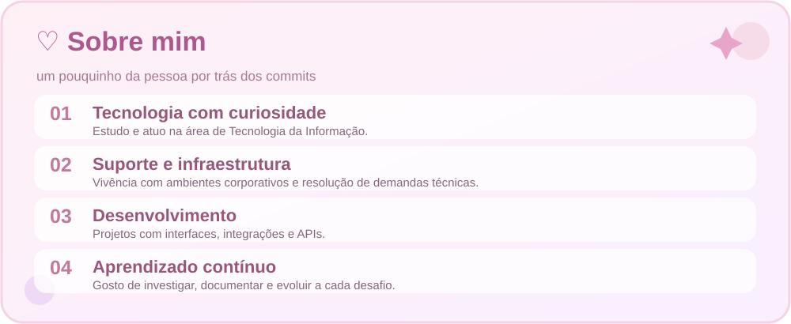
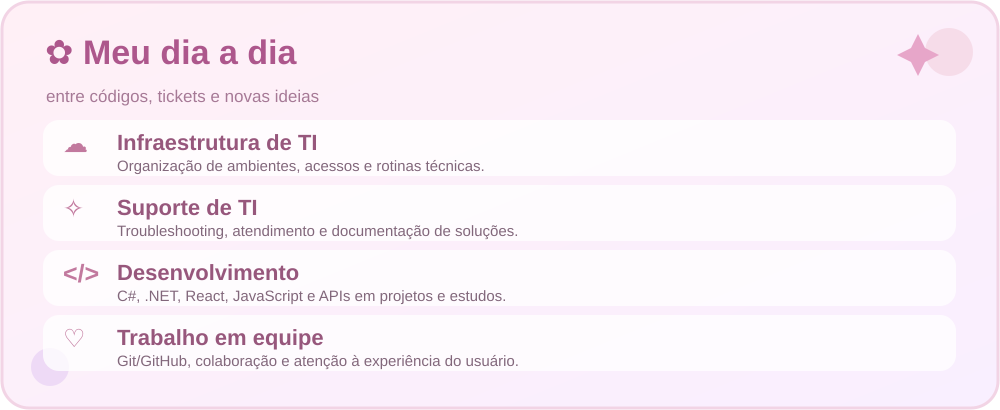
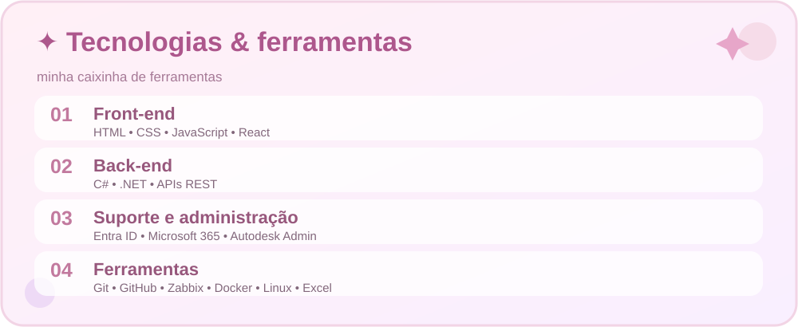
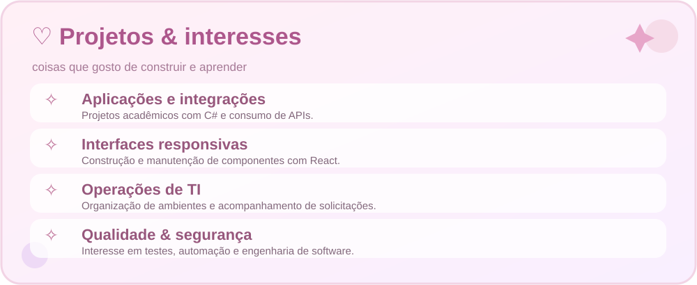
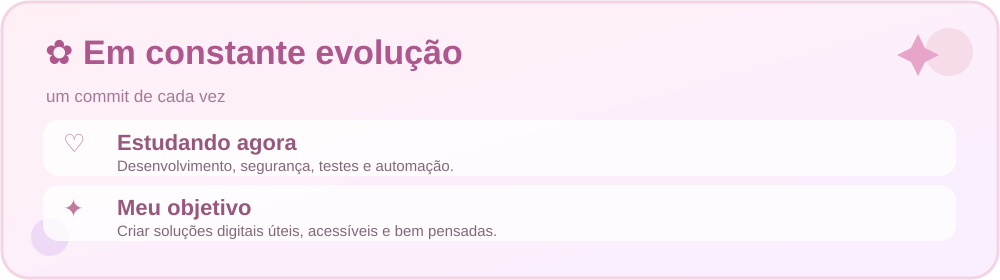

  
  <h2>Oi, que bom ter você aqui! ♡</h2>
  
🌷 Tecnologia, aprendizado contínuo e soluções construídas com carinho.

  
<b>Suporte de TI · Desenvolvimento · Experiência digital</b>

  
  
  
  
  
  
  
made with ♡, energético e muitos commits ☕ ✦

