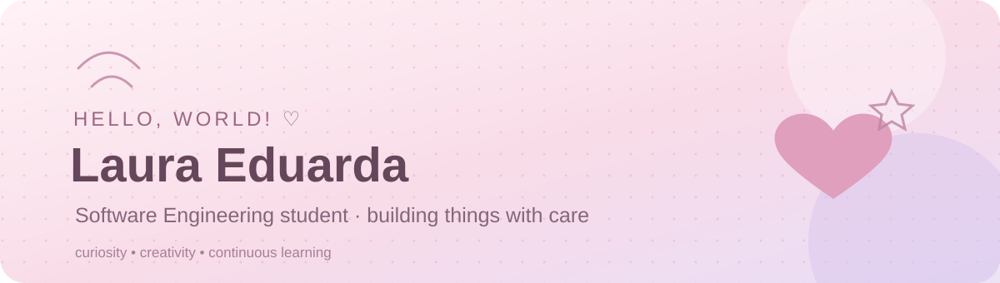
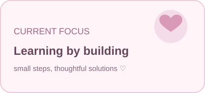

  
  
  

<i>Transformando curiosidade em conhecimento e ideias em projetos. ♡</i>

## ♡ Sobre mim

Oi! Eu sou a **Laura Eduarda**, estudante de **Engenharia de Software** na Universidade Positivo, em Curitiba (PR).

Atualmente, trabalho com **desenvolvimento frontend** e venho ampliando meus conhecimentos em tecnologia por meio de projetos colaborativos, estudos e experiências práticas. Gosto de unir código, criatividade e organização para construir soluções úteis e interfaces agradáveis.

Também tenho experiência profissional com atendimento e suporte em tecnologia, além de uma trajetória anterior em Desenvolvimento Humano e Organizacional (DHO), que fortaleceu minhas habilidades de comunicação, organização e colaboração.

## ✿ Minha trajetória

### 💻 Tecnologia | Stok IA / TKTech
- Atuação com atendimento ao cliente e suporte relacionado à plataforma.
- Contato com demandas de usuários, ferramentas de inteligência artificial e orientações de uso.
- Apoio na comunicação de instabilidades, atualizações e soluções.
- Experiência em contexto de tecnologia e colaboração com diferentes demandas da equipe.

### 🌸 Desenvolvimento Humano e Organizacional | SEGULA
- Criação de materiais de comunicação interna e layouts no Canva.
- Apoio à organização de webinars, treinamentos e ações para colaboradores.
- Atualização de controles, relatórios e calendários de comunicação.
- Apoio em iniciativas de endomarketing, eventos internos e relacionamento com fornecedores.

## 🎀 O que venho desenvolvendo

- **Frontend:** desenvolvimento e construção de interfaces.
- **Git e GitHub:** colaboração em projetos, versionamento e trabalho em equipe.
- **APIs:** consumo e integração com APIs, além do uso e gerenciamento de chaves de API.
- **C#:** conhecimentos básicos da linguagem e exploração de seus fundamentos.
- **UX/UI:** interesse em experiência do usuário, usabilidade e design de interfaces.
- **Figma:** criação, exploração e organização de layouts e protótipos.

## 🧁 Tecnologias e ferramentas

<i>Aprendendo, testando e evoluindo um projeto de cada vez. 🌷</i>

## ☁️ Além do código

- ✧ Gosto de aprender sobre UX/UI e pensar na experiência de quem utiliza uma aplicação.
- ✧ Tenho interesse por criatividade e comunicação visual.
- ✧ Valorizo projetos colaborativos e a troca de conhecimento.
- ✧ Estou sempre buscando aprender novas ferramentas e tecnologias.
- ✧ Inglês em nível intermediário, em constante evolução.

## 💌 Vamos nos conectar?

  

Feito com carinho, café e algumas linhas de código. ♡

